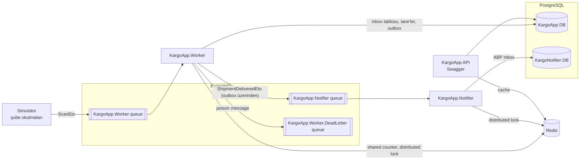

# KargoApp

Bir kargo takip sistemi üzerinden **ABP Framework**, **background worker**, **concurrency**, **RabbitMQ** ve **Redis** öğrenmek için yazılmış bir proje.

Amaç ürün değil, her aşamada bir konuyu gerçekten kavramak. Tasarım kararları sadece yazılıp bırakılmadı, bilerek bozularak denendi: worker işlem ortasında öldürüldü, RabbitMQ kapatıldı, iki worker aynı anda çalıştırıldı, bozuk mesaj gönderildi.

**Teknolojiler:** ABP 10.7 (.NET 10) · PostgreSQL · RabbitMQ 4 (ABP Distributed Event Bus) · Redis · EF Core · Docker Compose

## Öne çıkanlar

- **Paralel ve çakışmasız işleme:** `FOR UPDATE SKIP LOCKED` ile kargo bazında kilitlenen paralel lane'ler. 1 lane, tek tek: ~320/sn → 4 lane, 50'lik paket: **~4.500/sn**.
- **Kayıpsız alma:** Kendi inbox tablomuz ve idempotency. Worker işlem ortasında öldürüldü, kayıp yok.
- **Sırasız mesajlar:** Exponential backoff ile iki worker'da **3.279 hata → 0**.
- **Poison message:** Hata sınıflandırma ve dead-letter queue. Bozuk mesaj **265.000 deneme → 1**.
- **Transactional outbox / inbox:** RabbitMQ kapalıyken teslim olayları outbox'ta bekledi, açılınca gitti. Bildirim ayrı bir servis (Notifier).
- **Thread pool starvation:** Publish paralelliği 100'e çıkınca sistemin ilk dakika donduğu ölçüldü ve teşhis edildi.

Detaylar: **[Tasarım](docs/TASARIM.md)** · **[Deneyler ve ölçümler](docs/DENEYLER.md)**

## Mimari



| Bileşen | Görevi |
| --- | --- |
| **API** (`HttpApi.Host`) | Kargo oluşturma, sorgulama, iptal, tek tek hareket ekleme. Takip sorgusu Redis'te cache'lenir. |
| **Simulator** | Şubelerin barkod okutmalarını taklit eder: kargoları oluşturur, okutmaları paralel olarak RabbitMQ'ya publish eder. |
| **Worker** | Okutmaları toplu ve paralel işler; kargo teslim edilince outbox'a olay yazar. |
| **Notifier** | Ayrı bir servis. Teslim olaylarını ABP inbox'ı ile alır ve müşteriye bildirim gönderir (log'a yazar). |

## Aşamalar

Her aşama ayrı bir PR.

| # | Konu | Öğrenilenler | PR |
| --- | --- | --- | --- |
| 0–1 | Kurulum, kargo oluştur / sorgula / iptal | ABP katmanları, DDD, aggregate root, Application Service, Unit of Work | [#1](../../pull/1) |
| 2 | Kargo hareketleri, durum kuralları | Geçiş tablosu domain'de, unit test, Redis cache-aside | [#2](../../pull/2) |
| 3 | Simulator → RabbitMQ → Worker | ABP Distributed Event Bus, exchange/queue/binding, ack, `async/await`, `SemaphoreSlim` | [#3](../../pull/3) |
| 4 | Worker: toplu ve paralel işleme | Kendi inbox tablomuz, `FOR UPDATE SKIP LOCKED`, `BackgroundService`, idempotency | [#4](../../pull/4) |
| 5 | Yük, sırasız mesaj, poison message | Exponential backoff, dead-letter queue, Redis shared counter, ölçüm | [#5](../../pull/5) |
| 6 | Teslim bildirimi | Transactional outbox / inbox (ABP), distributed lock, ayrı servis, retry politikası | [#6](../../pull/6) |

## Çalıştırma

**Gerekenler:** .NET 10 SDK, Docker

1. Altyapı (PostgreSQL, RabbitMQ, Redis):
   ```bash
   cp .env.example .env          # şifreleri doldur
   docker compose up -d
   ```
2. Şifreler commit'lenmez; her projenin klasöründe `appsettings.secrets.json` oluştur (şifreler `.env`'deki değerler):

   | Proje | Gerekenler |
   | --- | --- |
   | `HttpApi.Host`, `DbMigrator` | `ConnectionStrings:Default` |
   | `Worker`, `Simulator` | `ConnectionStrings:Default` + RabbitMQ şifresi |
   | `Notifier` | `ConnectionStrings:Notifier` (veritabanı `KargoNotifier`) + RabbitMQ şifresi |

   Örnek (Worker):
   ```json
   {
     "ConnectionStrings": { "Default": "Host=localhost;Port=5432;Database=KargoApp;User ID=kargo;Password=<POSTGRES_PASSWORD>;" },
     "RabbitMQ": { "Connections": { "Default": { "Password": "<RABBITMQ_PASSWORD>" } } }
   }
   ```
3. Veritabanı: `dotnet run --project src/KargoApp.DbMigrator`
4. Dead-letter için RabbitMQ arayüzünden (`http://localhost:15672`) bir kez elle kur:
   - Exchange: `KargoApp.DeadLetter` (fanout)
   - Queue: `KargoApp.Worker.DeadLetter`, bu exchange'e bağlı
5. Servisler (ayrı terminallerde):
   ```bash
   dotnet run --project src/KargoApp.Worker
   dotnet run --project src/KargoApp.Notifier
   dotnet run --project src/KargoApp.Simulator -- --shipments 100 --parallelism 10
   ```
   API ve Swagger: `dotnet run --project src/KargoApp.HttpApi.Host` → `https://localhost:44343/swagger`

Worker ayarları komut satırından değiştirilebilir, örneğin `--ScanProcessing:Lanes=8 --ScanProcessing:ShipmentsPerBatch=100`.

## Bilerek kapsam dışı

UI yok (Swagger yeterli) · gerçek SMS/e-posta yok (log) · multi-tenancy yok · Kubernetes / bulut deploy yok · MassTransit yok (mesajlaşmanın tek yolu ABP Distributed Event Bus).
