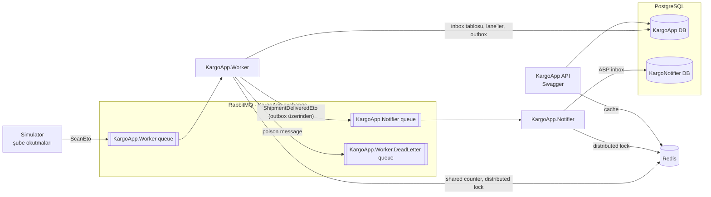

# KargoApp

Bir kargo takip sistemi üzerinden **ABP Framework**, **background worker**, **concurrency**, **RabbitMQ** ve **Redis** öğrenmek için yazılmış bir proje.

Amaç ürün değil, her aşamada bir konuyu gerçekten kavramak. Her aşama ayrı bir PR. Tasarım kararları sadece yazılıp bırakılmadı, bilerek bozularak denendi: worker işlem ortasında öldürüldü, RabbitMQ kapatıldı, iki worker aynı anda çalıştırıldı, bozuk mesaj gönderildi. Sonuçlar aşağıdaki tablolarda.

**Teknolojiler:** ABP 10.7 (.NET 10, layered template, UI yok) · PostgreSQL · RabbitMQ 4 (ABP Distributed Event Bus) · Redis · EF Core · Serilog · Docker Compose

---

## Mimari



| Bileşen | Görevi |
| --- | --- |
| **API** (`HttpApi.Host`) | Kargo oluşturma, sorgulama, iptal, tek tek hareket ekleme. Takip sorgusu Redis'te cache'lenir. |
| **Simulator** | Şubelerin barkod okutmalarını taklit eder: kargoları oluşturur, okutmaları paralel olarak RabbitMQ'ya publish eder. |
| **Worker** | Okutmaları toplu ve paralel işler; kargo teslim edilince outbox'a olay yazar. |
| **Notifier** | Ayrı bir servis. Teslim olaylarını ABP inbox'ı ile alır ve müşteriye bildirim gönderir (log'a yazar). |

API ve Worker aynı Domain projesini kullanır; kargo durum geçiş kuralları tek yerde (`Shipment.ApplyMovement`) durur:

| Mevcut durum | İzin verilen okutma → yeni durum |
| --- | --- |
| `Created` | `DepartedBranch` → `InTransit` |
| `InTransit` | `ArrivedAtBranch` → `AtBranch` |
| `AtBranch` | `DepartedBranch` → `InTransit`, `OutForDelivery` → `OutForDelivery` |
| `OutForDelivery` | `Delivered` → `Delivered`, `DeliveryFailed` → `AtBranch` |
| `Delivered`, `Cancelled` | Hiçbiri (son durum) |

Bunun dışındaki her okutma `BusinessException` (`KargoAppDomainErrorCodes.InvalidShipmentStatusTransition`) ile reddedilir.

---

## Aşamalar

| # | Konu | Öğrenilenler | PR |
| --- | --- | --- | --- |
| 0–1 | Kurulum, kargo oluştur / sorgula / iptal | ABP katmanları, DDD, aggregate root, Application Service, Unit of Work | [#1](../../pull/1) |
| 2 | Kargo hareketleri, durum kuralları | Geçiş tablosu domain'de, unit test, Redis cache-aside (`IDistributedCache`) | [#2](../../pull/2) |
| 3 | Simulator → RabbitMQ → Worker | ABP Distributed Event Bus, exchange/queue/binding, ack, `async/await`, `SemaphoreSlim`, thread pool starvation | [#3](../../pull/3) |
| 4 | Worker: toplu ve paralel işleme | Kendi inbox tablomuz, `FOR UPDATE SKIP LOCKED`, `BackgroundService`, idempotency | [#4](../../pull/4) |
| 5 | Yük, sırasız mesaj, poison message | Exponential backoff, dead-letter queue, Redis ile shared counter, ölçüm | [#5](../../pull/5) |
| 6 | Teslim bildirimi | Transactional outbox / inbox (ABP), distributed lock, ayrı servis, retry politikası | [#6](../../pull/6) |

---

## Öne çıkan çözümler

### 1. Mesajı kaybetmeden, toplu işlemek: kendi inbox tablomuz

ABP'nin hazır inbox'ı handler'ı her olay için **tek tek** çağırıyor ve bunu global bir distributed lock altında sırayla yapıyor. Handler okutmayı toplu işlemek için bir pakete koyup beklerse ABP olayı "işlendi" sayıyor; paket yazılamadan worker çökerse okutma kaybolur. Toplu ve paralel işleme ile kayıpsızlığı birlikte sağlamak için inbox elle kuruldu:

- `ScanEtoHandler` gelen okutmayı sadece `AppIncomingScans` tablosuna yazar; ABP sonra ack eder. Böylece RabbitMQ'dan mesaj, DB'ye kaydedilmeden asla silinmez.
- **Idempotency:** ScanId primary key. Aynı mesaj ikinci kez gelirse `UniqueViolation` yakalanır ve atlanır.
- Asıl işi sabit sayıda **lane** (`BackgroundService`) yapar: her lane DB'den bir paket kargo alır, tüm okutmalarını uygular ve tek transaction'da commit eder.

### 2. Paralel ama çakışmasız: `FOR UPDATE SKIP LOCKED`

```csharp
// ScanBatchHandler: EF Core FromSqlInterpolated, {…} değerleri SQL parametresi olarak gider
var shipments = await db.Shipments.FromSqlInterpolated($@"
    SELECT * FROM ""AppShipments""
    WHERE ""IsDeleted"" = false
      AND ""TrackingNumber"" IN (SELECT ""TrackingNumber"" FROM ""AppIncomingScans""
                                 WHERE ""ProcessedAt"" IS NULL
                                   AND (""NextAttemptAt"" IS NULL OR ""NextAttemptAt"" <= {now}))
    LIMIT {maxShipments}
    FOR UPDATE SKIP LOCKED")
    .IgnoreQueryFilters()
    .ToListAsync();
```

- Kilit **okutmaya değil kargoya** konur: aynı kargonun okutmaları aynı anda iki lane'de işlenemez.
- `SKIP LOCKED`: başkasının tuttuğu kargoyu beklemeden atla, boşta olanı al. Lane'ler ve birden çok worker kopyası birbirini hiç beklemez.
- Kilit transaction'la birlikte açılır; worker çökerse PostgreSQL kilidi anında bırakır. Kargo kilidi için Redis lock gerekmez. Projede Redis lock sadece ABP'nin outbox/inbox işleyicileri için kullanılıyor (bkz. 5).

### 3. Sırasız gelen mesajlar: exponential backoff

RabbitMQ mesajları iki worker'a dağıtınca aynı kargonun okutmaları DB'ye farklı sırayla düşebiliyor. Örneğin `ArrivedAtBranch`, kendisinden önce olması gereken `DepartedBranch`'ten önce işlenmeye çalışılıyor ve geçiş kuralı onu reddediyor. İlk denemede 10.000 okutmanın **3.279'u** bu yüzden reddedildi.

- Geçersiz geçiş hemen hata sayılmaz: okutma **ertelenir** (2 → 4 → 8 → 16 sn), 5. denemede de geçersizse hatalı işaretlenir.
- Aynı kargonun paketteki sonraki okutmaları onunla birlikte bekler (deneme hakları yanmaz).
- Sonuç: **3.279 hata → 0**.

### 4. Poison message ve dead-letter queue

DB'ye hiç sığmayan bozuk bir mesaj, ABP hata durumunda her zaman `nack (requeue: true)` gönderdiği için **80 saniyede 265.000 kez** denendi. RabbitMQ 4.3'te `nack` quorum queue'nun `x-delivery-limit` sayacını da artırmıyor.

- Handler hatayı **sınıflandırır**: PostgreSQL'in kalıcı veri hataları (`22xxx`, unique dışındaki `23xxx`) tekrar denenmez. Mesaj, hata sebebiyle birlikte (`x-error` header) `KargoApp.DeadLetter` exchange'ine gönderilir.
- Geçici hatalar (DB'ye ulaşılamıyor gibi) eskisi gibi kuyruğa döner ve tekrar denenir.
- Sonuç: 265.000 deneme → 1 deneme + DLQ'da bekleyen mesaj.

### 5. Transactional outbox / inbox: servisler arası kayıpsız taşıma

Kargo `Delivered` olunca müşteriye bildirim gitmeli. "DB'ye yazdım ama RabbitMQ'ya gönderemeden çöktüm" (**dual-write** problemi) olmamalı.

```text
Worker (tek transaction)                         Notifier (ayrı servis, ayrı DB)
  okutmalar + kargo Delivered                      RabbitMQ → AbpEventInbox (MessageId unique) → ack
  + AbpEventOutbox'a olay        ── COMMIT         InboxProcessor → handler
OutboxSender → RabbitMQ  ─────────────────────►    hata: RetryLater (2, 4, 8… sn)
```

- `PublishAsync`, Unit of Work içindeyse olayı göndermez; commit'le birlikte outbox tablosuna yazar. Rollback olursa olay da yok olur.
- OutboxSender ve InboxProcessor birden çok kopyada çakışmasın diye **Redis distributed lock** kullanır.
- Notifier ayrı bir servis: sadece `Domain.Shared`'a (event sözleşmesine) bağlı, kendi kuyruğu ve kendi veritabanı var. Bildirim yavaşlarsa ya da çökerse okutma işleme etkilenmez.

### 6. Shared counter: Redis `HINCRBY`

Her worker kendi bellek içi sayacını tutuyordu; iki worker'ın toplamı görünmüyordu. Paket commit'ten sonra şube bazlı sayılar Redis'e `HINCRBY` ile yazılıyor. Tek komut atomik olduğu için iki worker aynı anda artırsa da sayım kaybolmuyor. Redis'e ulaşılamazsa paket bozulmuyor, sadece uyarı yazılıyor.

---

## Ölçümler ve deneyler

### Publish paralelliği (Simulator, 10.000 okutma)

| Paralellik | Saniyede | Not |
| --- | --- | --- |
| 1 | ~20 | Her publish ~50 ms bekliyor |
| 10 | ~2.250 | Beklemeler üst üste biniyor: async'in asıl gücü |
| 100 | ilk ~60 sn **0**, sonra ~3.000 | **Thread pool starvation**. `DOTNET_ThreadPool_ForceMinWorkerThreads` ile teşhis doğrulandı |

### İşleme hızı (Worker, 4.000 okutma)

| Lane | Paket (kargo) | Saniyede | Not |
| --- | --- | --- | --- |
| 1 | 1 | ~320 | Her kargo için ayrı transaction |
| 1 | 50 | ~1.600 | Batching tek başına 5× |
| 4 | 50 | ~4.500 | 4× değil ~2,8×: lane'ler aynı DB için yarışıyor |

### Dayanıklılık deneyleri

| Deney | Sonuç |
| --- | --- |
| Queue yokken publish | Mesajlar kayboldu (exchange bırakacak yer bulamadı) |
| Worker kapalıyken 10.000 okutma | Queue'da bekledi, worker açılınca işlendi |
| Worker'ı işlem ortasında öldürmek | Kayıp yok; tekrar gelen 1 mesajı idempotency yakaladı |
| İki worker, 10.000 okutma | Backoff öncesi 3.279 hata, sonrası **0** |
| Poison message | 265.000 deneme → 1 deneme + DLQ |
| Notifier kapalıyken 50 teslimat | Kaybolmadı, açılınca işlendi |
| RabbitMQ kapalıyken 50 teslimat | Outbox'ta bekledi; RabbitMQ açılınca 6 sn içinde gitti |
| Bildirimde %20 hata (`--Notifier:FailurePercent=20`) | Retry ile geçti; 6 kez üst üste hata alan 1 olay **discard** edildi (bilinen eksik: ABP inbox'ında DLQ yok) |

---

## Çalıştırma

**Gerekenler:** .NET 10 SDK, Docker

1. Altyapı (PostgreSQL, RabbitMQ, Redis):
   ```bash
   cp .env.example .env          # şifreleri doldur
   docker compose up -d
   ```
2. Şifreler commit'lenmez; her projenin klasöründe `appsettings.secrets.json` oluştur (şifreler `.env`'deki değerler):

   | Proje | Gerekenler |
   | --- | --- |
   | `HttpApi.Host`, `DbMigrator` | `ConnectionStrings:Default` |
   | `Worker`, `Simulator` | `ConnectionStrings:Default` + RabbitMQ şifresi |
   | `Notifier` | `ConnectionStrings:Notifier` (veritabanı `KargoNotifier`) + RabbitMQ şifresi |

   Örnek (Worker):
   ```json
   {
     "ConnectionStrings": { "Default": "Host=localhost;Port=5432;Database=KargoApp;User ID=kargo;Password=<POSTGRES_PASSWORD>;" },
     "RabbitMQ": { "Connections": { "Default": { "Password": "<RABBITMQ_PASSWORD>" } } }
   }
   ```
3. Veritabanı: `dotnet run --project src/KargoApp.DbMigrator`
4. Dead-letter için RabbitMQ arayüzünden (`http://localhost:15672`) bir kez elle kur:
   - Exchange: `KargoApp.DeadLetter` (fanout)
   - Queue: `KargoApp.Worker.DeadLetter`, bu exchange'e bağlı
5. Servisler (ayrı terminallerde):
   ```bash
   dotnet run --project src/KargoApp.Worker
   dotnet run --project src/KargoApp.Notifier
   dotnet run --project src/KargoApp.Simulator -- --shipments 100 --parallelism 10
   ```
   API ve Swagger: `dotnet run --project src/KargoApp.HttpApi.Host` → `https://localhost:44343/swagger`

Worker ayarları komut satırından değiştirilebilir, örneğin `--ScanProcessing:Lanes=8 --ScanProcessing:ShipmentsPerBatch=100`.

---

## Bilerek kapsam dışı

UI yok (Swagger yeterli) · gerçek SMS/e-posta yok (log) · multi-tenancy yok · Kubernetes / bulut deploy yok · MassTransit yok (mesajlaşmanın tek yolu ABP Distributed Event Bus).
